# FPGA Based CNN and SNN Implementation

Project team:

- Mathias Rønne ( [Mrej112](https://github.com/Mrej112) )

- Søren Stückler ( [sorenstuckler](https://github.com/sorenstuckler) )

- Jakub Rewak ( [Fred0809](https://github.com/Fred0809) )

- Ioannis Zagkas ( [Trixompalas](https://github.com/Trixompalas) )

## Summary of the vision task

In this assignment, a SNN and CNN network will be trained to recognise different shapes. As a group we have chosen to challenge ourselves with 6 different shapes.

Triangle / Square / Rectangle / Figure 8 / Circle / Ellipse.

Our dataset has been generated using python script `generate_shapes_dataset.py`. This generates shape images in a 160x120 pixels sizes and in 8-bit grayscale representaton. We have chosen to limit problematic rectangles and ellipses so that their shorter dimmensio can be of size in 30-55% range of the longer dimmension. This makes it less likely to have exactly round ellipses, effectively circles, and quareish rectangle, effectively squares. From our observations both networks achieve pretty good accuracy results relatively quickly and spend a lot more time trying to distinguish between this group of images. Overall, the images in dataset can have up to +/-180deg random rotation, size of the shape can be of 30-90% size of the whole picture height. Their position can be >3 pixels from image border and line thichness is 9-10 pixels. We have tried couple of different setting for the noise of our dataset and settled with medium noise level at value 0.4 which introduces curved lines, possible gaps in shape outlines, and stray dots throughout the image. We are also using 42 as common seed value to make accurately test our approach.

The example set of our shapes with sizes and orientation

  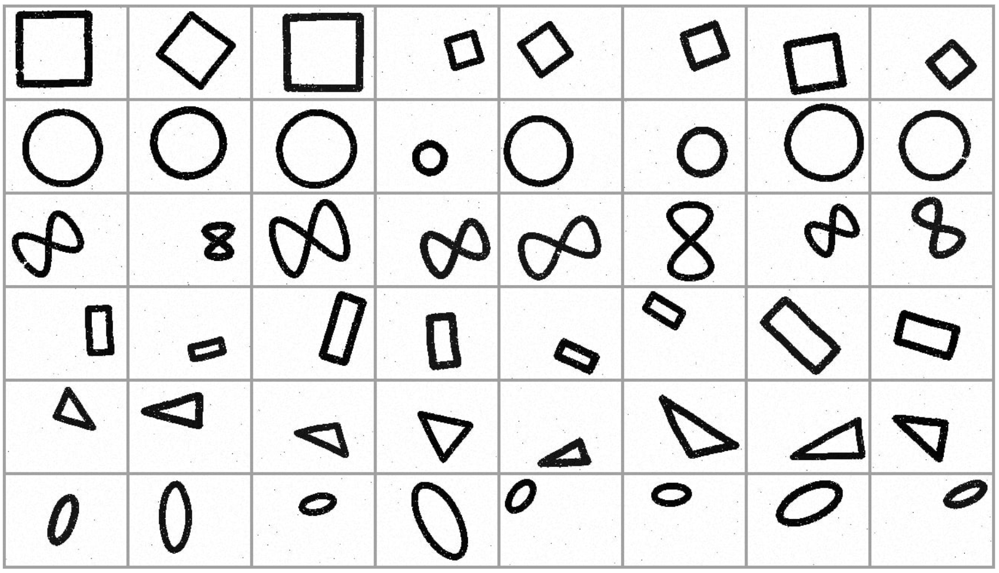

We can see that our dataset introduces a lof of possible variations as well as makes some shapes, like squares and rectanglus or ellipses and circles, particularly simmilar to each other in some configurtatiosn

  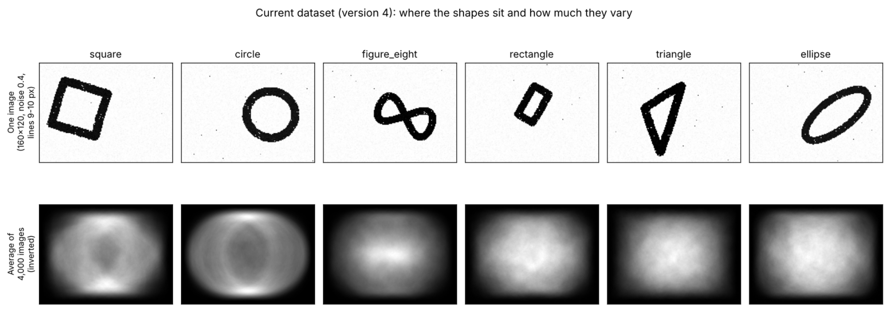

We have generated 50k images per shape which is then used in a 70/30% split for training a validation data. It gives us 35k and 15k smaller dataset. Additionally we have additional datase for testing which has 4k images for each shape.

## CNN and SNN Hrdware and software architecture

### CNN Architecture
The architecture of the convolutional neural network (CNN) is shown in the image below

  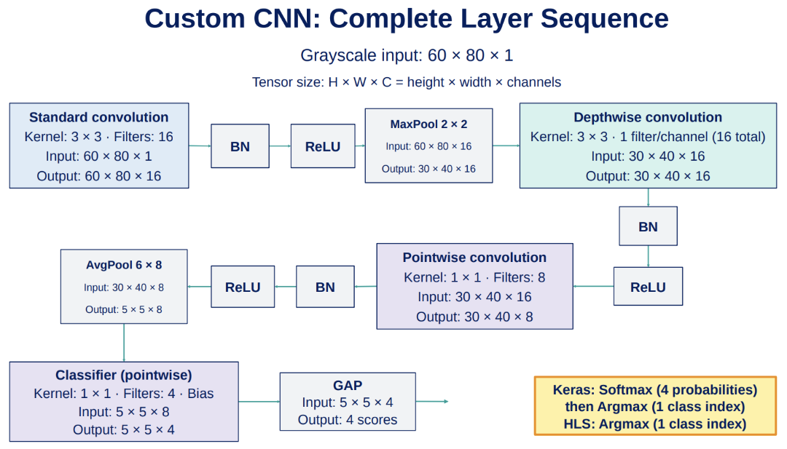

The full CNN design is shown in the video, where every layer is briefly explained, using one of the 120x160 resolution training images for visual clarity as it goes through each layer. The layers shown in the video are all implemented using a python script, `train_cnn.py`, for training a model with the chosen data set that features 6 different shapes.

Total parameters used = 464 weights + 6 classifier biases + 80 trainable BN + 80 non-trainable BN = 630 

  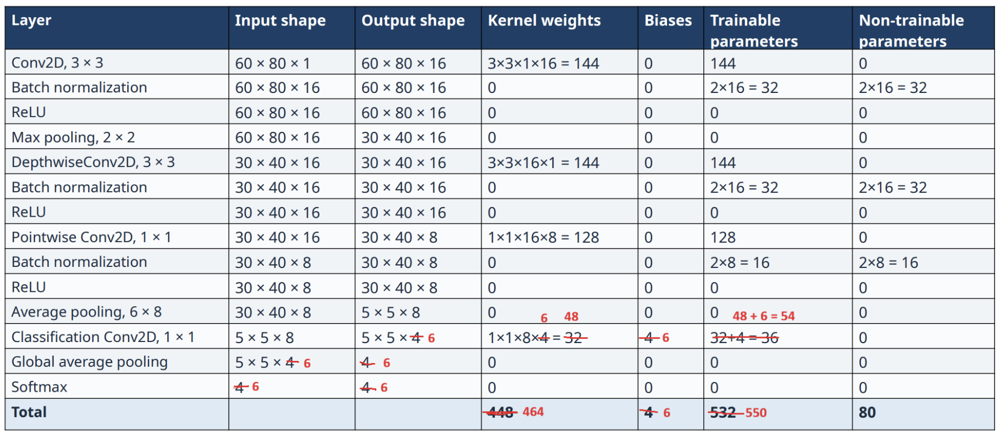

A weight is generated for each of the 4 important layers (Convolution, Depthwise, Pointwise and Classifier Layer) alongside a BIAS due to the usage of batch normalization and a class specific bias for the classifier layer). To reduce the workload of the CNN, the images are resized from 120x160 to 60x80 and normalized afterwards so each pixel of an image has a number range of -2 (black) to 2 (white) instead of 0 (black) to 255 (white), which is the standard 8-bit greyscale range. The smaller number range helps speed up the network processing time.

The obtained weights and bias, from model training, are placed into an HLS component in Vitis, which translates the CNN layers into C-language. HLS components can be exported and used in Vivado. The CPU side of the PYNQ board will therefore be responsible for providing the CNN layers logic to the FPGA. The Vivado design will provide the programmable logic for the FPGA. Its main task is to store test images and transfer them into the HLS IP for CNN so the trained network model can test if it recognizes the input image and give a predicted label.  

System architecture as implemented in Vivado block diagram of the CNN architecture:

  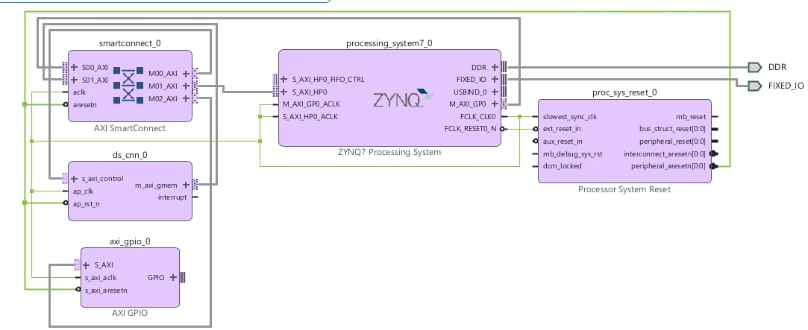

Adress editor view in Vivado of the CNN architecture:

  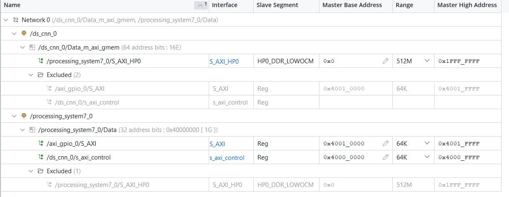

A UART python script is used for transferring test images from a folder, into the CNN, stored within the FPGA chip. Vitis is used as a bridge for the PYNQ board’s CPU to retrieve the images, sent from UART, and store them within the BRAM of the FPGA so they can be processed by the CNN block, which was generated using the HLS code. CPU is therefore both used for providing the CNN network logic and for transmitting images from UART to the FPGA. Once a test input image has been through the CNN network, the CPU side will send back a raw output value (logit) through UART. This procedure is repeated for all test images. All logit outputs are turned into labels, using argmax, in order to generate a confusion matrix
A block diagram of the full procedure is showcased in the video. 

### SNN Architecture
In the video, we talked about how the weights are generated and how the SNN works briefly. Here, we are going to write about the first path of the image processing on the PC using Python code and a little more detail of the Network.
Image processing:

  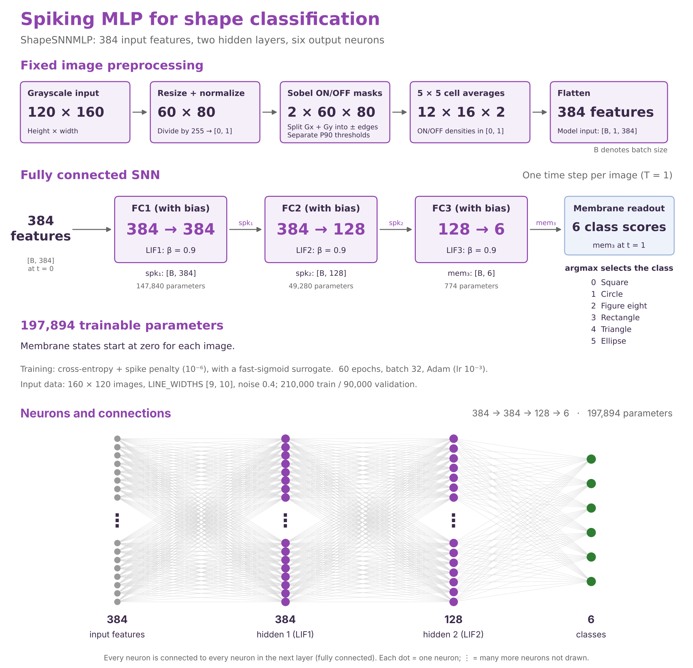

We send images of 120 by 160 pixels, and through a procedure called Bilinear Resizing we scale them to 60 by 80 pixels. The procedure basically tries to fit in same length less amount of pixels. We find the new center x of the pixel, and each value between 0 and 255 of the old pixel is multiplied by its corresponding weight, which depends on the distance from the new center. Next, we use a Sobel operator to generate 2 spike maps (ON/OFF). We use two kernel filters of a 3x3 grid, one on the x-axis and one on the y-axis with corresponding values, to multiply and sum the individual values of the pixels, while also using padding (mirroring the opposite side of the grid at the end of the other) so we can get the same grid dimensions for the spike maps. This is called convolution. After generating the 2 spike maps, we add them together to one single matrix G. Then, we notice that the G matrix will have negative and positive values. Our job now is to separate these values into a positive and a negative matrix, multiplying the negative matrix by (- 1) and then normalizing both of them by dividing by their maximum value + ε (a small value so we make sure we don't divide by 0). Now we need to find our P90 threshold, where we let 10% of the values spike. First, we need to find which values we are gonna use to set the threshold by using this math equation: index = 0.9*(N-1), where N is the number of values we have. For example, for N=16, we get index 13.5. We sort the values of the matrix in ascending order, and P90 = (13th + 14th) / 2. If a value in the matrix is > P90, we replace it with a spike. The last thing we need to do is to resize the matrices again because they are too big for our board, with a procedure called 5x5 cell averaging where we sum 25 spikes and divide by 25 in order to get density values. Finally, we go from 2 x 60 x 80 to 2 x 12 x 16 features (384 in total). We come across another problem here where the density values are Float32, but we want them to be int16 for the FPGA, so we multiply each value by 128 and use the round function in Python to keep the integer part. We flatten both grids into one list of 384 numbers, and that list goes to the network. This list is multiplied by the weights we generated by training the model (Video), and this is where the heavy computing of the math happens while only using 8 DSP blocks. Then we shift right by 7 (same as /128), and it fires a spike if the result is > 128. The Video provides the rest of the path.

System architecture as implemented in Vivado block diagram of the SNN architecture:

  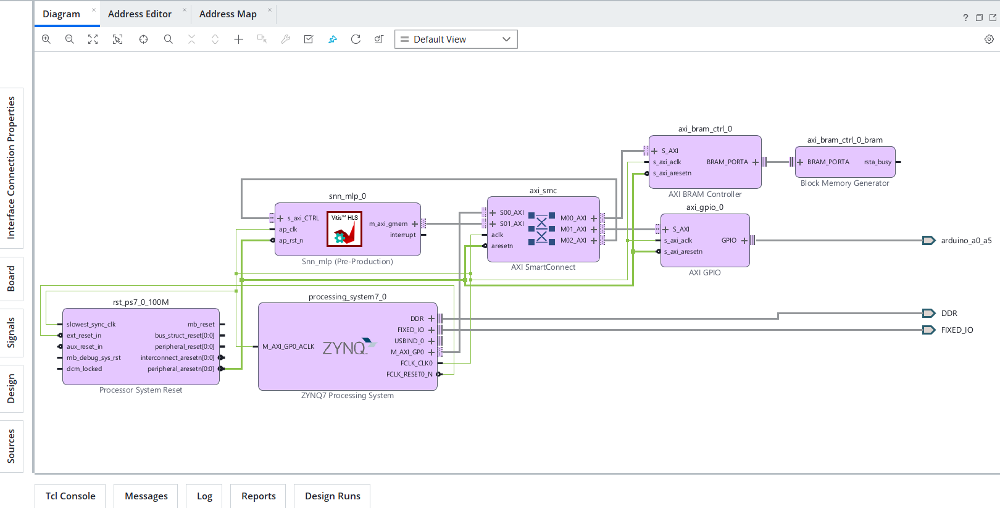

Adress editor view in Vivado of the SNN architecture:

  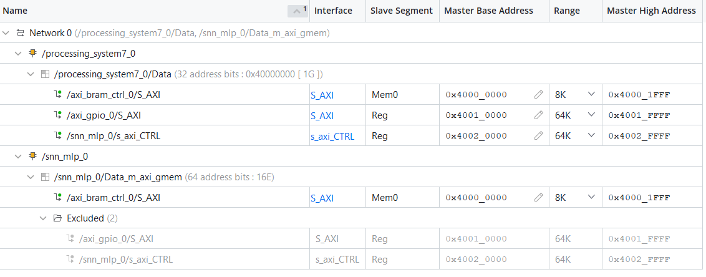

## UART protocol and memory arrangement.

  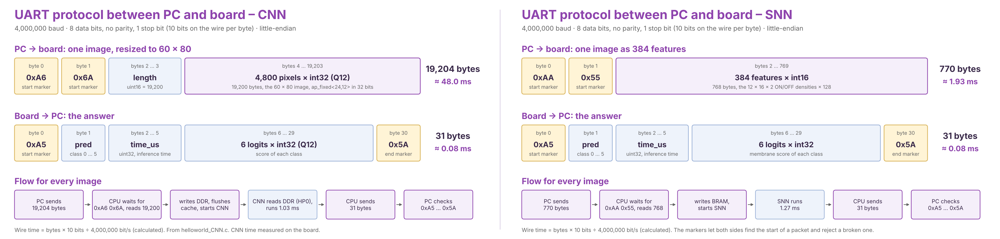

A change that needs to be acknowledged is that the original code of the dineshes network we get back from the board is 31 bytes instead of 23 due to the number of classes.

## Tests and performance comparison

The video showcases comparisons between CNN and SNN in more details

| Comparison Topic | Comment |
|:-------------|:--------|
| Overall and per class recognition | SNN had an easier time identifying rectangles and squares compared to CNN. CNN was however slightly better at recognizing circular shapes such as circles, figure eight and ellipses. Both networks weren’t good at identifying the handdrawn shapes, which could point to potential overfitting while training both networks. |
| Interference Latency    | SNN is approx. six times faster on average than the CNN due to the CNN requiring a lot of mathematical computation to process each image in the network, during training. |
| FPGA Timing    | Biggest timing difference is the Worst Negative Slack (WNS) where a signal reaches its destination with 3.448 ns to spare. Both networks don't have a negative value for slack so their FPGA designs meet timing requirements. CNN also has more endpoints due to DSP’s requiring more data paths.     |
| FPGA resource utilization   | The most interesting part is the BRAM and DSP usage. SNN mainly uses BRAM for its network while CNN uses a mix of BRAM and DSP as the DSP parts are needed for all the math calculations within the network.    |
| Power/Energy for post synthesis Data    | Both networks use similar power with CNN using slightly more due to the DSP’s it utilizes. CNN at 1.711 W and SNN at 1.573 W.    |

Overall and per class recognition accuracy on our generated dataset:

  <table>
    <tr>
      <td>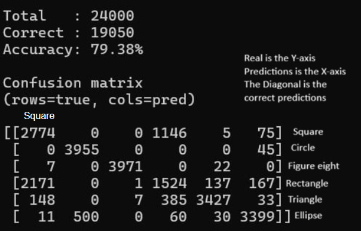</td>
      <td>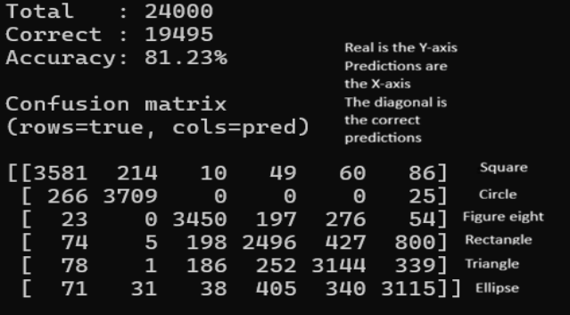</td>
    </tr>
  </table>

Aaccuracy in our prepared hand-drawn shape dataset:

  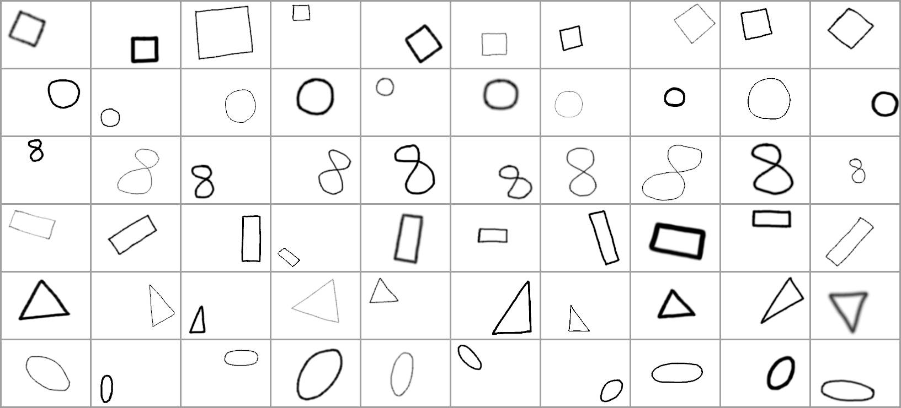

<table align="center">
  <tr>
    <td style="border: none;">
      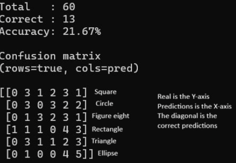
    </td>
    <td style="border: none;">
      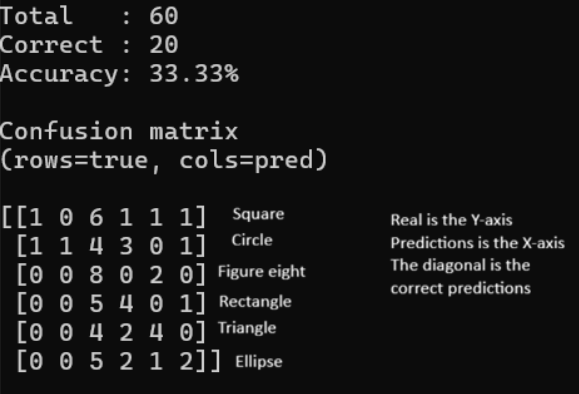
    </td>
  </tr>
</table>

Latency running on the actual PYNQ board:

<table align="center">
  <tr>
    <td>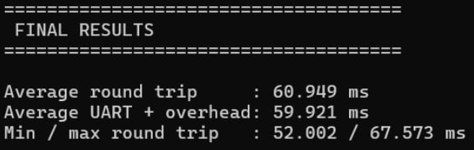</td>
    <td>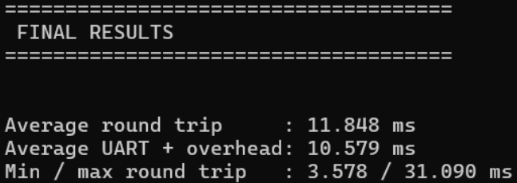</td>
  </tr>
</table>

Timing as displayed in Vivado tools:

<table align="center">
  <tr>
    <td>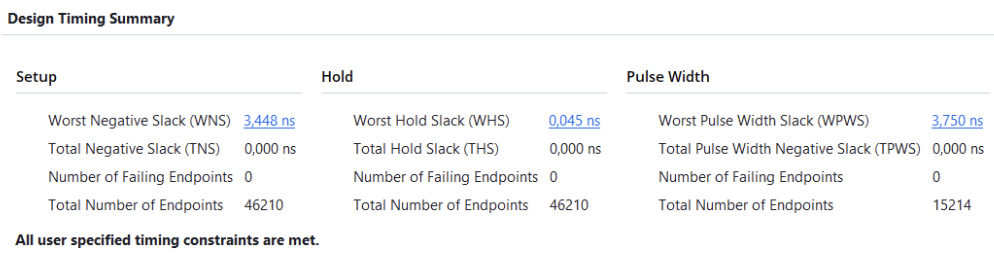</td>
    <td>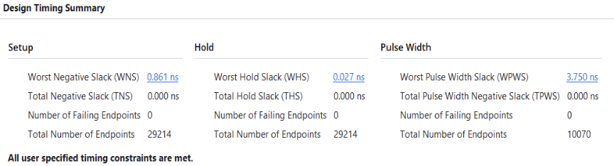</td>
  </tr>
</table>

Resource utilization of the architecture:

<table align="center">
  <tr>
    <td>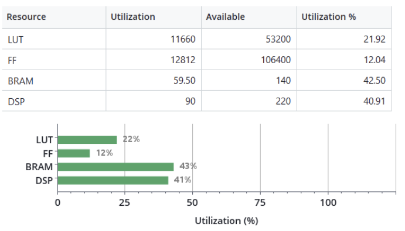</td>
    <td>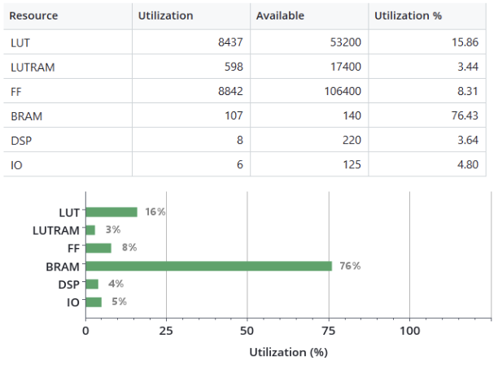</td>
  </tr>
</table>

Power usage summary:

<table align="center">
  <tr>
    <td>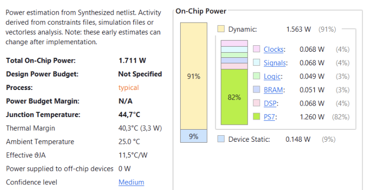</td>
    <td>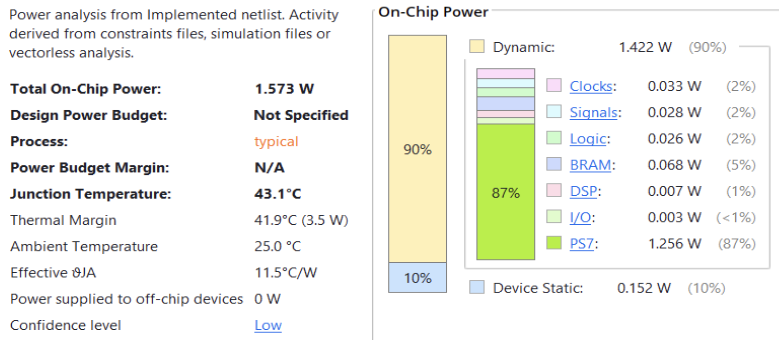</td>
  </tr>
</table>

## Future improvements

GAP (Global average pool) vs Grid Pooling
The image is divided into a 5x5 grid with information of 8 different features. With the global average pooling (AvgPool) averages all 25 bins together, leaving only 8 learned informational values about features like corner/curves/straight lines and so forth. This is all that the classifier has to go on. 

With 8 features x 6 shapes = 48 weights + 6 biases = 54 learned numbers in total.

All the position information is thrown away. This is pretty important in shapes where the only defining difference is stretching, like the rectangle and the ellipse vs the square and rectangle. The network only knows what features exist, but not where. 

Improvement for the future, keep the grid cells instead of averaging them. Like in SPP (Spatial pyramid pooling), but as we use only one level, we have chosen to refer to it as grid pooling here. The 5x5x8 bins are flattened directly into 200 numbers x 6 shapes = 1200 weights.  Every class has its own weight for every feature in the region. Meaning that every class learns a coarse spatial template. Now the network can tell that rectangles have long narrow cells, where the square comes in a compact block and the same with circles vs ellipses.

  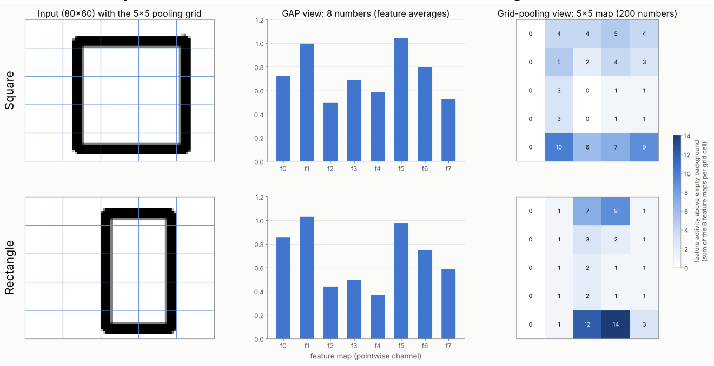

A small test was made with 2000 images per shape for 60 epocs, making for 83% accuracy on test score.

| Metric | GAP (old) | Grid Pooling (new) |
|----------|----------|-------------------|
| Classifier input | 8 values (feature averages) | 200 values (5×5 regions × 8 features) |
| Spatial information kept | none | coarse 5×5 layout |
| Classifier weights + biases | 8×6 + 6 = 54 | 200×6 + 6 = 1,206 |
| Trainable parameters, whole network | 550 | 1,702 |
| Classifier weight memory (16-bit) | 108 bytes | ~2.4 KB |
| Classifier latency (HLS) | 249 cycles ≈ 2.5 µs | 228 cycles ≈ 2.3 µs |
| Whole CNN latency | 1.075 ms (HLS) | 1.099 ms (HLS) |
| Vivado LUT / FF / BRAM / DSP | 4,647 / 5,525 / 34.5 / 86 | 4,548 / 5,677 / 37.5 / 83 |
| Validation accuracy (same data, 60 epochs) | 68% | **83%** |

  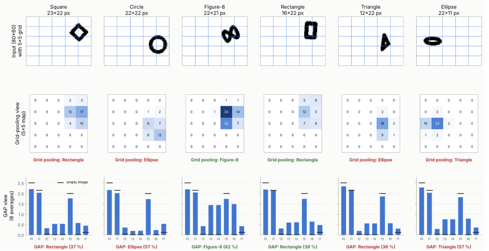

## Conclusions

Overall both networks turned out to have good and simmilar accuracy. From the confusion matrices we can see that CNN is doing much better at round shapes, almost perfect, while SNN has better accuracy in distinguishing rectangles from squares because of the coarse map of 12x16 that locate where the spikes are. The SNN weaknesses are the ellipse and rectangle.

  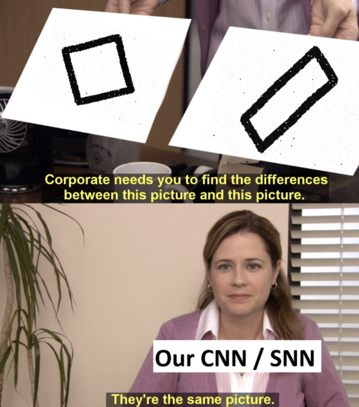

